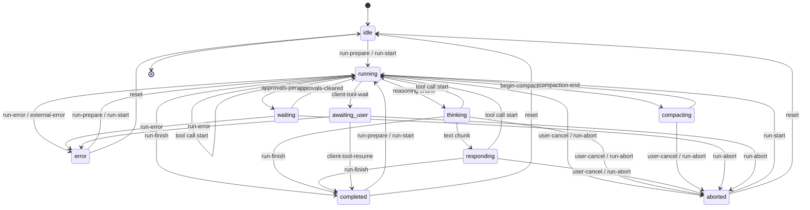
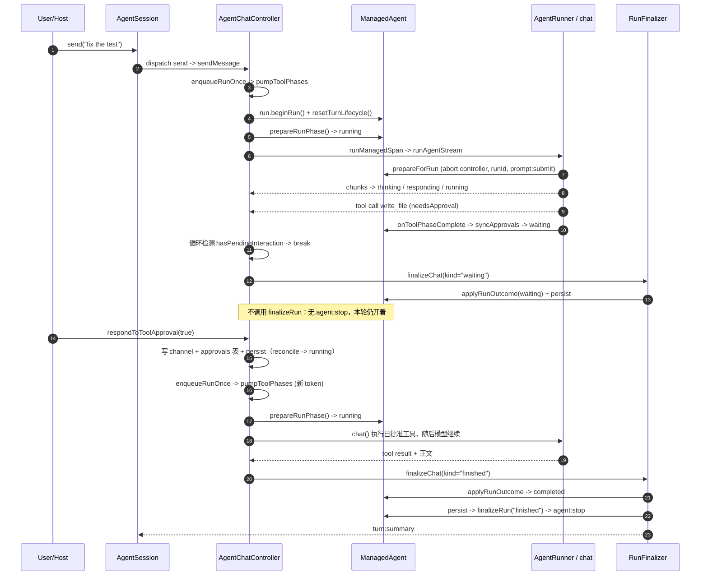

# Agent 运行流程

本文描述 `@codent/core` 里一次对话是怎么跑起来的：谁拥有哪份状态、status 如何跳转、一次 run 从
prepare 到 finalize 的完整链路、并发与顺序靠什么维持、各类失败分别走哪条恢复路径，以及那些
"看起来可以省掉、其实省掉就出错" 的约束。

所有结论都来自源码；每个小节给出 `path:line`。`packages/core/ARCHITECTURE.md` 已按代码校对
（校对记录见文末）；如后续再出现不一致，以代码为准。

**一句话：** 一个 user turn = `prepare → chat() → 工具相位循环 → finalize`；只要还有未决交互
（审批 / `ask_user`）pump 就停在用户身上，**所有"重试"都是 attempt 级**（同一个 turn、同一个
pump），只有 `finalizeRun` 才写 `agent:stop`。

**建议阅读顺序：** §1–2 建立角色与状态模型 → §3 跟着一次 run 走主线 → §4–5 看并发与错误分支
→ §6–8 查事件、不变量和源文件；文末是校对记录。

约定：

- **user turn（用户轮）**：从一条用户输入（`prompt:submit`，含新 `runId`）到 `agent:stop`。
- **pump**：一次 `AgentChatController.pumpToolPhases` 调用。一个 user turn 通常是 1 个 pump，
  触到工具相位上限时会再排一个 pump（同一 user turn），见 §3.5。
- **model iteration（模型轮）**：一次 LLM 请求 + 它发出的工具调用。TanStack 的 `onIteration` 计数。
- **chat() 调用**：一次 `runAgentStream` → `chat()`。恢复重试会重建它，但它不结束 pump。

---

## 1. 角色与边界

| 角色 | 文件 | 拥有什么 | 不拥有什么 |
|---|---|---|---|
| Host / `AgentSession` | `packages/core/src/agent-session/local-agent-session.ts:1`、`types.ts:73` | 订阅与命令入口。把 agent 作用域的 `AgentEventBus` 事件按 `AGENT_EVENT_META.channel` 投影成 session channel | 不推导状态、不扫消息找审批（`interaction` channel 由 core 派生） |
| `AgentManager` | `packages/core/src/managers/agent-manager.ts:198` | agent 注册表、per-agent scoped bus（`of(agentId, parentId)`）、磁盘 session 归属表（`sessionId → agentId`）、root log 扩展 | 不驱动单次 run |
| `ManagedAgent` | `packages/core/src/managers/managed-agent.ts` | 组合根：status、error、UI channel、usage，以及 session 级状态（todos / plan / approvals / mode）、`RunCoordinator`、`RunFinalizer`、各 service | 不做工具相位循环（那是 controller） |
| `AgentChatController` | `packages/core/src/managers/controllers/agent-chat-controller.ts:50` | 对话消息链（`AgentUIChannel`）、steer/follow-up 队列、run chain/epoch/token、工具相位循环、turn 级 finalize 调用 | 不拥有 abort controller（`RunCoordinator` 是唯一创建点） |
| `AgentRunner` | `packages/core/src/agent/runner/agent-runner.ts:103` | 只持有不可变配置 + `chat()` 包装。**run 之间无状态** | 不持有 status/session/usage |
| TanStack `chat()` | `packages/core/src/agent/runner/agent-runner.ts:151` | AG-UI chunk 流、工具执行、`agentLoopStrategy: maxIterations(...)`、middleware 调度 | 不决定 turn 何时结束 |
| `runManagedSpan` / `runAgentOnce` | `packages/core/src/agent/run/managed-span.ts:40`、`run-agent-skeleton.ts:124` | 一次 LLM span：attach channel → 拉流 → 归一化 abort/error/empty | 不拥有队列/审批（chat pump）或 task 结果投影（subagent） |
| `RunFinalizer` | `packages/core/src/managers/run-finalizer.ts:72` | end-of-run 顺序：`applyRunOutcome` → persist → `finalizeRun` → `turn:summary`；`deriveChatOutcome` 的优先级也在这里 | 不决定 pump 要不要继续（controller 读消息链判定）；它只按给定的 `kind` 落定 |

### 1.1 两个 run profile

| | InteractiveChat（root 对话） | Worker（`task` / 内部 worker） |
|---|---|---|
| 入口 | `AgentChatController.pumpToolPhases` (`agent-chat-controller.ts:502`) | `runSubagent` → `executeSubagentRun` (`agent/subagent/run-subagent.ts:94`) |
| span | 每个工具相位一次 `runManagedSpan`，`outcome` 留给 pump (`agent-chat-controller.ts:655`) | 一次 `runManagedSpan`，`outcome` 由 `finalizeSubagentTask` 走 `path: "detached"` (`task-result.ts:105`) |
| run token | 有（`RunCoordinator.beginRun`，唯一调用点 `agent-chat-controller.ts:504`） | 无；靠自身 abort signal + status |
| 结束判定 | 循环读消息链（`shouldContinueAgentPump`）+ 队列 | 一次流结束即结束 |
| `flagEmptyStream` | 开（空流=错误）(`agent-chat-controller.ts:660`) | 关（空流按正常结束）(`run-subagent.ts:279`) |
| abort 形状的异常 | 保留为失败回合：status `error` + 文本（`abortErrorAsCancel: false`，`onExternalError` 是终态） | 视为取消（`abortErrorAsCancel: true`，`run-subagent.ts:282`） |
| finalize | `finalizeChat` → `finalizeRun(kind)`（`waiting` 除外） | `finalizeDetached(kind)` |
| extensions / memory / todo / session store | 有（仅 root 装配，`agent-factory.ts:125-172`） | 无（`agent-factory.ts` 的 `!parentId` 分支之外全不装配；`MemoryService.runExtraction` 因无 manager 直接返回，`memory-service.ts:166-167`） |
| session 级自动压缩 | 有（`agent-factory.ts:138` 设 compaction 配置） | 不触发（`compaction-middleware.ts:86` 的 `!isSubagent` 条件） |
| reactive compact | 有 | 从不（`reactive-compact-retry.ts:35`、`managed-agent-compact.ts:56`） |

`task` 的可见性由 profile + task id 决定，不是另一套 UI 策略：
`projectsToTask = effectiveProfileId !== "internal" && parentTaskToolCallId` (`run-subagent.ts:119`)。

---

## 2. 状态模型

状态集合定义在 `packages/core/src/runtime-types/agent-status.ts:5`：

```ts
type AgentStatus =
  | "idle" | "running" | "completed" | "error" | "aborted"
  | "waiting" | "awaiting_user" | "compacting" | "thinking" | "responding";
```

`RunFinalizeReason = "finished" | "aborted" | "error"`（同文件 `:17`）——**没有** `"waiting"`：
等待不是 turn 的结束，见 §3.5 与 §7 第 11 条。

### 2.1 三个谓词，回答三个不同问题

| 谓词 | 集合 | 回答的问题 | 用在哪 |
|---|---|---|---|
| `isTerminalStatus` (`:36`) | `aborted` `error` `waiting` `awaiting_user` | "流正常结束时**不许被覆盖**" | `resolveFinishStatus` (`:45`)、`onRunFinish` |
| `isActiveStatus` (`:40`) | `running` `thinking` `responding` `waiting` `awaiting_user` `compacting` | "现在有活可干，abort 能改变点什么" | abort 监听器 (`managed-agent-run-lifecycle.ts:87`)、`abortManagedAgentRun` (`:197`)、`ctx.isIdle()` (`managed-agent.ts:1580`) |
| `shouldDeferMidRunQueue` (`agent/queue/defer-mid-run-queue.ts:11`) | `pumpDepth > 0` 或 `waiting`/`awaiting_user` | "这条新输入该排队还是直接开跑" | `shouldDeferQueue` (`agent-chat-controller.ts:398`) |

关键点：**`completed` 不在 `TERMINAL_STATUSES` 里，也不在 `ACTIVE_STATUSES` 里**。
它不是"终止态"，而是"正常结束写下的那个值"，因此下一次 `onRunStart` 可以把它推进 `running`。
`waiting` / `awaiting_user` 同时是"terminal（结束时不覆盖）"和"active（abort 有意义）"——
它们是**停在问题上的开放轮**，不是已结束的轮。

`managed-agent-run-lifecycle.ts:62-90` 记录了一次真实误用：abort 监听器曾用
`isTerminalStatus` 判断，结果 `completed` 不受保护、而审批暂停反而拒绝被 abort。两个表不能互换。

### 2.2 状态含义与写入者

| Status | 含义 | 终止？（见上表定义） | 写入者 |
|---|---|---|---|
| `idle` | 无 run，且没有未答问题 | 否（settled） | `resetToIdle`（`agent-status-controller.ts:244`，由 session reset 调用 `session-lifecycle-service.ts:150`） |
| `running` | 正在跑（工具/等待模型继续） | 否 | `prepareRunPhase` (`:104`)、`onRunStart` (`:120`)、`TOOL_CALL_START` (`:75-78`)、`approvals-cleared`、`before-tool-call`、`compaction-end` |
| `thinking` | 收到 reasoning chunk | 否 | `REASONING_MESSAGE_*` (`:80-83`) |
| `responding` | 正在输出正文 | 否 | `TEXT_MESSAGE_CONTENT`，且当前是 `running`/`thinking` (`:85-89`) |
| `waiting` | 停在未决定的工具审批上 | 是（结束不覆盖） | `syncApprovals(count>0)` (`:207`)、`reconcile`（`pendingCount>0`，`:254`） |
| `awaiting_user` | 停在 `ask_user` 上 | 是 | `setClientToolWaiting(true)` (`:228`)、`reconcile`（`hasPendingAskUser`，`:258`） |
| `compacting` | 压缩摘要进行中 | 否 | `beginCompaction` (`:177`)，auto / reactive / manual 三处调用 |
| `completed` | 上一轮正常结束 | 否（settled） | `onRunFinish` → `resolveFinishStatus`、`reconcileAfterRun`、`client-tool-resume` |
| `aborted` | 被用户/abort 中止 | 是 | `onUserCancel` (`:170`)、abort 监听器、`abortManagedAgentRun` |
| `error` | 流/外部失败 | 是 | `onRunError` (`:146`)、`onExternalError` (`:163`)、`applyRunOutcome` (`:309-321`) |

`waiting` / `awaiting_user` / `aborted` 是**粘性**的：`applyChunkStatus` 在开头直接返回
(`:66-67`)，残留 chunk 不能把它们改回 `running`。

### 2.3 转换表

| From | To | 触发（trigger） | 位置 |
|---|---|---|---|
| `idle` `completed` `error` `aborted` `waiting` | `running` | `run-prepare`（且无未决审批） | `agent-status-controller.ts:104-118` |
| `idle` `completed` `error` `running`... | `running` | `run-start`（跳过 `aborted`/`waiting`/`awaiting_user`） | `:120-128` |
| `running` `thinking` `responding` | `thinking` | `chunk:reasoning` | `:80-83` |
| `running` `thinking` | `responding` | `chunk:text` | `:85-89` |
| 任意非粘性 | `running` | `chunk:tool` | `:75-78` |
| 非终止 | `completed` | `run-finish`（`resolveFinishStatus`，无 error） | `:135-140` |
| 非终止 + error 文本 | `error` | `run-finish` | `runtime-types/agent-status.ts:45-49` |
| `running` 等 | `waiting` | `approvals-pending` / `reconcile` | `:196-219`、`:254-257` |
| `waiting` | `running` | `approvals-cleared` / `before-tool-call` / `run-prepare` | `:200-203`、`:221-226` |
| 任意 | `awaiting_user` | `client-tool-wait` / `reconcile` | `:228-237`、`:258-261` |
| `awaiting_user` | `completed` | `client-tool-resume` | `:239-241` |
| 任意 | `compacting` | `compaction:auto` / `compaction:reactive` / 手动 | `:177-187` |
| `compacting` | `running` | `compaction-end` | `:189-194` |
| `running` `thinking` `responding` `compacting` | `aborted` | `user-cancel` | `:170-175` |
| active（见 §2.1） | `aborted` | `run-abort`（abort 监听器） | `managed-agent-run-lifecycle.ts:87-89` |
| 任意 | `error` | `run-error` / `external-error` / `apply-outcome` | `:146-168`、`:309-321` |
| 任意 | `idle` | `reset`（session 切换/reset） | `:244-247` |

### 2.4 状态机



补充说明（图里省略以免交叉过多）：

- `waiting → running` 还有两条路径：`before-tool-call`（工具开始执行，`:221`）和
  `run-prepare`（审批已答完、新 pump 开始，`:104`）。
- `waiting`/`awaiting_user` 可以被 `reconcile` 直接改写（例如恢复会话时消息链里已无未决项，
  按 `whenClear` 落 `idle`/`running`/`completed`，`:249-265`）。
- 图只画了最常见的交叉；按 §2.3 的表格，**任意 active 状态**（`running`/`thinking`/`responding`/
  `compacting`/`waiting`/`awaiting_user`）都可因 `run-error` / `external-error` 落 `error`，
  也都在 session reset 时落 `idle`。这些边省略是为了不让图变成毛线团，语义以表格为准。
- `compact` 期间若 `endCompaction` 看到的状态不是 `compacting`（被 session reset 改了），
  它什么都不做（`:189-194`）。
- `beginCompaction` 不检查当前状态（表格里写“任意”）；实际触发点都在 run 中——auto/reactive 发生在
  `onConfig`，手动 `/compact` 会先拒绝运行中的 agent（`local-session-dispatch.ts:93-99`），
  所以图里只画 `running → compacting`。

---

## 3. 一次 run 的生命周期

### 3.1 时序（审批暂停 → 工具续跑 → finalize）



### 3.2 prepare

pump 入口 (`agent-chat-controller.ts:502-524`)：

1. `token = managed.run.beginRun()` —— 使上一个 token 失效，返回本次的 token (`run-coordinator.ts:126`)。
2. `pumpDepth += 1`，`resetTurnLifecycle()`（重置 `turnLifecycleFinalized`，`run-coordinator.ts:224`），
   `clearPrepareAsContinuation()`，`setError("")`。
3. `applyCancelledIncompleteTools()`：只清理被截断/不可解析的残留 tool call
   (`:675-686` → `incomplete-tool-calls.ts:43`)，不动待审批与有效 `input-complete`。
4. `statusController.prepareRunPhase(messages)`：**有未决审批时直接返回**（`:105`），
   所以"审批没答完就再发一条消息"不会偷跑一次模型。

真正的 `prepareForRun` 在 `executeManagedAgentRun` 里 (`managers/run-agent.ts:345`)，
而 `runAgentStream` 是惰性 async generator（`run-agent.ts:387-398`），因此它在消费者第一次拉流时才执行
（以下四条的行号指 `packages/core/src/managers/managed-agent-run-lifecycle.ts`）：

- `RunCoordinator.setupAbortController(signal, { onAborted })` —— **abort controller 的唯一创建点**
  (`run-coordinator.ts:38`)；监听器只在 `isActiveStatus` 时写 `aborted` (`:87`)。
- `resetReactiveCompactRetries()`、`resetMaxOutputTokensOverride()`（上一相位的截断升级不带过来，`:92-94`）。
- `isToolContinuation = !forcedNewTurn && (isToolContinuationPrepare(status, messages) || flaggedContinuation)`
  (`:102-103`；判定见 `tool-phase-utils.ts:224`：`waiting`/`awaiting_user`，或最后一条不是 `user`）。
  `forcedNewTurn` 是唤醒回合的"新回合但无 prompt"标记（`consumePrepareAsNewTurn`），它压过消息链推导，
  否则唤醒会被当成工具续跑、丢掉 `runId`。
- 非续跑才换 `runId` 并 `log.setRun(runId)` (`:111-116`)；非续跑 **且非 subagent** 才
  `collectExtensionPromptHooks` + `prompt:submit` (`:118-130`)；唤醒轮带上 `setPromptlessTurn`（`:104-106`）。

`AgentRunner.run` 只做三件事：解析 abort controller（managed 路径必须传 owner controller，
否则抛错，`agent-runner.ts:117-143`）、建 `ToolRunContext`、调 `chat()`（`:151-174`）。

### 3.3 一次 chat() 内部

`runStreamWithRecovery`（`managers/run-stream-recovery.ts:193`）包住 `runner.run`：

- 先 `resetWireOverride()` + `armCapabilityStrip(...)`（`:196-201`），这两项是 **wire-only** 状态，
  由 `wire-recovery` middleware 在 channel 投影之后施加（否则被 `compaction` 的投影覆盖）。
- 逐个 chunk 转发；`RUN_ERROR` 进恢复阶梯（§5.1），`RUN_FINISHED{finishReason:"length"}` 进截断阶梯。
- 把每次尝试的 retry 状态写进 `agent:retry` + L1 `retry` 字段（`:336-344`）。

channel 侧：`consumeAgentStream` → `AgentUIChannel.consumeRun`，每个 chunk 落到消息链；
run 结束 `finalizeStream()` 去掉尾部空 shell 并补 tool display (`ui-channel.ts:440-457`)。
`consumeRun` 用 `sessionGeneration` 做守卫：会话已切换就直接返回，不再 finalize 旧 transcript
(`:482-487`)。

### 3.4 工具相位与"续跑"

`pumpToolPhases` 的循环（`agent-chat-controller.ts:527-549`）每次迭代：

1. token 失效或 epoch 变了 → 直接 `return`（不 finalize，见 §4）。
2. `hasPendingInteraction(current)` → `break`（挂在用户问题上，不能进模型）。
3. `toolPhase > 0` 时走 `prepareContinuationPhase`（`:467-489`）：
   - `needsToolPhaseContinue` → 标记续跑，不再注入用户消息（工具还没跑完）；
   - 否则先 drain **steer**（同一 turn、下一次 LLM 调用前送达）；
   - 若刚 steer 过、或 `needsAgentResponseAfterTools` → 标记续跑；
   - 否则 drain **follow-up**（只在该停的时候）。
4. `executeStream(messages, token)` —— 一次 `chat()`。
5. 若 `status === "error"` 记 `hasError`；token 失效则 `applyCancelledIncompleteTools(true)` + persist 后返回。
6. `syncPlanModeFromMessages()`、`autoApprovePending()`（auto/plan 执行期）、
   `await applyCommandSafetyPolicy()`（对 `run_command` 的命令安全策略，`:542`）。
7. `after` 再次检查 pending → break；`shouldKeepPumping`（工具还要续 / 队列有货）否则 break。

`MAX_TOOL_PHASES = 40`（`:32`）。触顶后若仍需要跑，会**不 finalize** 地再排一个 pump（`:570-575`）：
`reconcileWithPolicy(during-run)` → persist → `enqueueRunOnce()` → return。这样不会留下僵死的 `running`，
也不会把队列困在没人 drain 的 turn 里。

队列语义（一次说清）：

| 方法 | 何时 | 送达点 |
|---|---|---|
| `steer(content)` (`:270`) | 运行中"同轮修正"（程序化使用） | 每次 `prepareContinuationPhase`，下一次 LLM 调用前 |
| `followUp(content)` (`:287`) | 运行中按 Enter 的默认行为 | 只在"本来要停"的那一刻 |
| `sendMessage` (`:317`) | 空闲；或挂起时退化为 `steer`（`:321-324`） | 立即开 pump / 排队 |
| `forceSubmit` (`:308`) | Option/Ctrl+Enter | 先 `interruptCurrentRun(keepQueue: true)`，再插入本条并开新 pump |
| `popQueuedMessage` (`:235`) | 撤回最后一条（先 follow-up 后 steer） | — |

`markNextPrepareAsContinuation()`（`run-coordinator.ts:179`）只影响 `prepareForRun` 的
"要不要做一次性开销"（memory/扩展 hook、`prompt:submit`、新 `runId`），不改变 turn 归属。

### 3.5 结束判定

循环退出后（`agent-chat-controller.ts:570-587`）：

1. `outcomeKind = runFinalizer.deriveChatOutcome({ hasError, waitingForUser })`
   ——优先级 `aborted > error > waiting > finished`（`run-finalizer.ts:79-84`）。
2. 若 `outcomeKind` 是 `error`/`aborted`：**拒绝所有未决审批**（`:562-566`）。
   理由在注释里：终态轮不能带着一个没回答的问题，否则下一轮 `prepareRunPhase` 直接返回，
   会话看起来"死了"（`:557-561`）。
3. `keepPumping && outcomeKind === "finished"` → 不 finalize，再排 pump（§3.4）。
4. 否则 `finalizeChat`（`run-finalizer.ts:91-114`）：
   - `waitingForUser === false` 时 `discardPreforkRuns("run-finish")`（`:62-64`）；
   - `applyRunOutcome(...)`（status 落定）；
   - `persist()`（channel → session store）；
   - `kind !== "waiting"` 才 `finalizeRun(kind)`；
   - 最后 `turn:summary`（`kind === "waiting"` 时不带 `outcome`，`:110`）。

### 3.6 finalize 做了什么

`finalizeManagedAgentRun`（`managed-agent-run-lifecycle.ts:133-180`）：

```
beginTurnFinalize()  ← 每轮只允许一次，否则直接返回
clearPrepareAsContinuation()
recordStreamDuration()
persistSession()
clearTurnContext()
reason === "finished" ? memory.runExtraction(...) : skip
emit("agent:stop", { reason })
setCurrentRunId(null)
queueMicrotask(() => log.setRun(null))
```

三个顺序要点：

- **`applyRunOutcome` 在 persist 之前，persist 在 `finalizeRun` 之前，`turn:summary` 最后**
  （`run-finalizer.ts:5-9` 的注释把这条定为该类存在的原因）。
- `agent:stop` 之后才 `setCurrentRunId(null)`，而 `log.setRun(null)` 还要再晚一个 microtask：
  被取消工具的 `onAfterToolCall` 与 `turn:summary` 都在 `agent:stop` 之后到达，
  同步清空会让它们成为日志里没有 `run` 的孤儿行（`:149-165`）。
- memory extraction 只在 `finished` 跑，且用的是"当前 controller 的 signal"——
  它在 turn 已 settle 后运行，没有东西会中断它（`:136-146` 明确记录了这个限制）。

### 3.7 后台任务完成：空闲时唤醒

`run_command(run_in_background)` 的完成通知是**一次性推送**：`background-middleware` 在下一次模型调用
的 `onConfig` 里把 `<ctx kind=background_notification>` 同时写进 wire 和 channel，然后才 `markNotified`
（`background-middleware.ts:65-91`）。所以 agent 空闲时任务结束，通知只能等用户下次输入——用户看不见
"任务已经跑完"这件事。

补上的那一环在 core，不在 middleware：

```
registry.finish()  → notifyChange([job.id])        registry.ts:507
  → AgentCommandService.onJobsChange({ jobs, finished })
  → ManagedAgent：emit("session:jobs") + 若 finished 非空 → wakeForBackgroundJobs()   managed-agent.ts:1834-1873
      → collectCompleted() 只 peek（空则返回，不开空轮）
      → AgentChatController.wakeForBackgroundCompletion()   agent-chat-controller.ts:350-367
          → enqueueRunOnce()  → 首个 onConfig 注入通知 → 模型汇报完 → finalize
```

`finished` 字段存在的唯一理由是**区分"刚结束"和"恢复出来的历史"**：`ready()` 恢复磁盘记录时走同一个
变更通知，如果按"列表里有终态项"判断，`/resume` 一恢复就会自己开一轮。

唤醒回合是**真正的回合**：`markNextPrepareAsNewTurn()`（`run-coordinator.ts`）让它拿到自己的
`runId` 与回合边界（`turn:start` / `turn:summary` / `agent:stop`），否则 `isToolContinuationPrepare`
会因为它前面是一条 assistant 消息把整轮当成"工具续跑"，日志里这一轮就没有 `run` 归属。
但它没有 prompt，所以 `collectExtensionPromptHooks` / `prompt:submit` 被跳过——`(structured)` 不是查询。

唤醒只回答"要不要开一轮"，**投递仍然只发生在 middleware**（见 §7 第 15 条）：

| 当前状态 | 开新一轮？ | 说明 |
|---|---|---|
| `idle` / `completed` | 是 | 首个 `onConfig` 注入通知，模型读完汇报 |
| `aborted` / `error` | 否 | **显式白名单**：用户刚停掉（或它失败了），后台完成不该把它重新拉起来 |
| `compacting` | 否 | compaction 拥有 transcript，不能叠一轮 |
| pump 在跑，或 pump 已排队（`shouldDeferQueue`） | 否 | 通知随这次 run 的下一次模型调用送达（旧行为） |
| 停在用户身上（`waiting` / `awaiting_user`） | 否 | 同上；用户回答后的那次 pump 送达 |
| plan `ready`（等 review） | 否 | 用户正在看计划，且模型可能顺手改计划 |
| plan `planning` | 否 | 还没有被批准的计划，无人提示的回合可能去写 plan |
| plan `executing` / `retro` | 是 | 计划已批准（注意：这两个相位本来就自动批准工具） |
| 子 agent（`parentId` 存在） | 否 | 没有"用户"；worker 的轮次属于父 agent |

唤醒轮还会**跳过 post-run memory extraction**（`RunCoordinator.promptlessTurn`）：没有用户输入可记，
通知+汇报不值得再花一次 LLM 调用去写记忆。

---

## 4. 并发与顺序

### 4.1 四层护栏

| 机制 | 位置 | 作用 |
|---|---|---|
| `RunToken`（对象身份，非计数器） | `run-coordinator.ts:15`、`:126` | "我还是当前 run 吗"。`beginRun` 使旧 token 失效；漏检是可见的 API 缺口而不是口头约定 |
| `lifecycleEpoch` + `pendingRunEpoch` | `agent-chat-controller.ts:61-67`、`:116-120` | 会话清空/resume 后，为旧 transcript 排的 pump 不得开跑 |
| `pumpDepth` | `agent-chat-controller.ts:55`、`:507`、`:646` | 是否有 pump 正在执行（排队判定、`stop()` 判定） |
| `runChain` | `agent-chat-controller.ts:51`、`:439` | pump 串行化；`enqueueRunOnce` 合并同一时刻的多次请求 |

`enqueueRunOnce`（`:419-433`）的三条不变量：

- `runPending()` 为真就 join 已有链，不排第二个 pump（排队 pump 会**重读** channel，
  所以它之后到达的审批答复/工具结果由它处理，不需要第二次）。
- 只有 slot 所有者能清 `pendingRunEpoch`（`if (this.pendingRunEpoch === epoch)`），
  旧 epoch 的回调清不掉新 epoch 的 slot。
- epoch 不匹配直接 `return`，不开跑。

`runPending()` 存在的理由是 `pumpDepth` 关不掉的同 tick 窗口：两处状态变化都看到
`pumpDepth === 0`，各排一个 pump，第二个没活可干却仍会跑一次模型，产出一段没人要的回复
（`:399-409`）。

### 4.2 为什么"非当前 pump"既不能减 depth 也不能 finalize

`interruptCurrentRun`（`agent-chat-controller.ts:178-206`）是**唯一**负责 token 失效 + depth 归零的地方：

```
if (!keepQueue) clearQueuedMessages()
advanceLifecycleEpoch()
statusController.onUserCancel()      // 只在 running/thinking/responding/compacting 时写 aborted
managed.abort(reason)                // agent:abort + controller.abort + invalidate + 级联子 agent + 清 pre-fork
managed.run.invalidateCurrentRun()
pumpDepth = 0
applyCancelledIncompleteTools(true)
approvalDecisions.denyPendingApprovals(TOOL_CANCELLED_MESSAGE)
setPendingApprovalCount(0)
persistMessages("pump-complete")
managed.finalizeRun("aborted")       // turn 级 finalize 在这里发生
```

旧 pump 随后从 `await` 返回，它的 `finally` 只有在 `token.isCurrent` 时才 `pumpDepth -= 1`
（`:615-620`）。否则一个正在收尾的旧 pump 会把**新 pump** 的 depth 减掉，
接下来的 `sendMessage` 就会在"看起来空闲"时再开一个 pump，两个流同时写同一条消息链。
同理，旧 pump 不能走 outcome 分支：`if (!token.isCurrent) { ...; return; }`（`:529-534`、`:549`）
——turn 已经由打断者 finalize 过了。

`beginTurnFinalize`（`run-coordinator.ts:229`）保证 `agent:stop`/persist/memory extraction 每轮只发生一次；
`pumpToolPhases` 的 `catch` 路径在 finalize 前还会再查 `finalized`（`:597`）。

### 4.3 abort controller 的归属

`RunCoordinator` 持有：`currentAbortController`（每个 run 一个，`setupAbortController` 里先取消旧的）、
`pendingAbortControllers`（工具级，如 `webfetch`/`websearch`）、`externalAbortSignal` 的转发监听
（`run-coordinator.ts:38-81`）。`abort(reason)` 会先把 reason 送到 pending controllers，再送 current
（`run-coordinator.ts:100-108`）——reason 是跨进程判定的依据（`"user-cancelled"` vs `"(no reason)"`，
`managed-agent-run-lifecycle.ts:182-190`）。

`AgentRunner.resolveAbortController` 拒绝"runner 自建 controller"的老 bug 形状：
managed 路径不传 owner controller 会直接抛错，只有 `detached: true` 的脚本/探针才允许自建
（`agent-runner.ts:117-143`）。

### 4.4 用户操作 → 行为

| 场景 | 行为 |
|---|---|
| 运行中按 Enter（follow-up） | 入 `followUpQueue`；`agent` 本来要停时才 drain（`agent-chat-controller.ts:292-299`） |
| 运行中 `send`（程序化） | `shouldDeferQueue()` 为真则退化为 `steer`（`agent-chat-controller.ts:326-329`） |
| 停在审批上再发消息 | status `waiting` → 排队（`defer-mid-run-queue.ts:14`），不会插队进本轮 |
| Esc（运行中） | `stop()` → `interruptCurrentRun("user-cancelled")`：丢弃队列、abort、取消未完成工具、拒绝未决审批、finalize `aborted`（`agent-chat-controller.ts:134-143`） |
| Esc（空闲） | **no-op**。没有 pump、没有注册的 pre-fork、没有未决交互时直接返回（`agent-chat-controller.ts:141`）——否则会 abort 上一轮 finalize 仍在用的 controller |
| Esc（停在审批/ask_user） | 有未决交互 → 视为有效取消目标（`agent-chat-controller.ts:141`），走完整打断 |
| Option/Ctrl+Enter | `forceSubmit`：打断但**保留队列**，插入消息后立刻开新 pump（`agent-chat-controller.ts:313-320`） |
| 切会话/`/resume`/`/new` | `stopIfActive()`：只有 live pump 或注册的 pre-fork 才打断；**停着的会话不伪造 abort**（`agent-chat-controller.ts:168-172`） |
| 审批待定时开 auto / 进入 plan 执行 | `approvePendingApprovals()`：逐个写 channel + 表，然后**只排一个** pump（`approval-decision-coordinator.ts:66-73`） |
| 审批答案重复/迟到 | 第一次决定胜出，后续 inert（`approval-decision-coordinator.ts:49-52`） |

`isRunActive()`（`agent-chat-controller.ts:154-156`）= pump live **或** 停在交互上。`/compact` 用它拒绝在半个 turn 上打 checkpoint
（`agent-session/local-session-dispatch.ts:93-99`）。

### 4.5 会话切换 / 新建 / 恢复的顺序

`SessionLifecycleService` 把切换做成一个串行事务（`services/session-lifecycle-service.ts`）：

两阶段，一个提交点：**unload（清理）→ load（恢复，末尾才 adopt）**。

1. `serializeSwitch` 串行化所有切换；`settle()` 后拒绝新切换。
2. **unload**（`unloadCurrent`）：`stop(reason)` → `awaitSessionPersistIdle()`。
   `stop` 的顺序是契约：`abortManualCompaction` → `stopActiveRun` → `cascadeAbortToChildren` →
   `discardPreforkRuns` → `streamHub.endAllCommands`。先停生产者，再让它在途写的落定。
   unload **不 adopt 任何东西**，所以 load 失败时会话仍然停在原来那个会话上。
3. **load**（`restoreManagedSession`）：`readSessionForRestore`（load/hydrate/规范化写回，
   **不 adopt**）→ 准备（plan 文件、mode/approvals、`applyPersistedModel`）→ 一次同步提交
   （`ui.setMessages` + tracker + mode/approvals + `adoptRestoredSession` **最后**）→
   commit 之后只剩 best-effort（display name、`session:restore`、media misses、state 帧），
   失败只记 warn，不把已完成的切换报成失败。
   旧顺序在 read 里就 adopt，于是 read 之后的任何失败都会留下「一个会话的数据 + 另一个会话的
   transcript」，下一次保存按新 id 把目标会话日志改写成旧内容。
4. ownership 在提交点交接：`acquire(target)` 先、提交后 `release(leaving)`；load 未提交则
   `release(target)` 并把日志 sink 指回仍活跃的会话。
   `session:switch` 的 `messageCount` 是**被离开**会话的条数（unload 前快照），写回离开会话的
   sink 时带 `{ sessionBoundary: false }`，避免同一文件出现第二条分隔线。
5. `newSessionInner`：create + `acquire` → unload → `setSessionData(next)`（提交点）→
   `clearTranscript()` + `resetTransientState(full)`；提交后失败只修占用与 sink，不回滚新会话。
6. `resetTransientState` 一份有序清单，`full` / `resume` 两个作用域：`run.resetRunState()`
   （abort + 清 controller）、`resetTurnLifecycle`、status → `idle`、`memory.resetState`、
   `streamHub.clearAll`、`resetTurnContext`、`resetIterationProgress`…
   `resume` 不碰 mode/approvals/usage/todos——恢复失败时不能把当前会话的这些值清掉。
7. **切换会终止本会话的后台作业**（by design，不是泄漏）：`resetTransientState` →
   `host.resetCommandJobs()` → `registry.destroyAll()` 会 kill 运行中的进程，并删掉
   `.agents/cache/command-jobs/` 下该会话的记录与日志；只有"已终态且未通知"的记录被保留给
   下次恢复。所以后台作业的 *durable* 指的是**跨进程重启**，不跨会话切换——切换即视为
   "这个会话的工作结束了"。模型在切回来之后查不到旧 job 是预期行为。

---

## 5. 错误处理与恢复

### 5.1 恢复阶梯（attempt 级，不换 turn）

`attemptErrorRecovery`（`run-stream-recovery.ts:91-142`）对每个错误按固定顺序试：

| 顺序 | 策略 | 判定 | 效果 | strategy |
|---|---|---|---|---|
| 1 | reactive compact | `isPromptTooLongError` 且非 subagent（`reactive-compact-retry.ts:30-41`） | 写 SUMMARY 到 channel，重投影，重试同一条流 | `reactive_compact` |
| 2 | capability strip | `isMultimodalUnsupportedError` 且本次流还没 strip 过（`capability-sanitize.ts:53-67`） | 把 drop set 扩到**全部**多模态类型（wire-only），重试 | `capability` |
| 3 | transient backoff | 429/502/503/504 或网络特征（`transient-retry.ts:75-86`） | `delay = min(2000·2^n, 32000) + 0~25%`，有 Retry-After 就用它（`run-stream-recovery.ts:66-70`） | `transient` |
| — | 放弃 | `recoveryAttempts >= 3`（`:99-106`）或都不匹配 | `throw`，进入终止路径 | — |

约束：

- 每次尝试前检查 `signal.aborted`（`:98`、`:213-217`）；backoff 是可中断 sleep（`:179-191`），
  所以 Esc 不会被 32s 等待拖住。
- 重启式重试会 `prepareRestartStyleRetry`（`:380-396`）：清 attempt 级 UI（**不动消息历史**）、
  丢弃这一尝试期间预启动的 `task`、清 error、把 status 从 `error` 拉回 `running`。
- 截断（`finishReason === "length"`）走另一条：先一次性把 `maxOutputTokens` 升到
  `ESCALATED_MAX_TOKENS = 64000`（不占恢复预算），之后最多 `MAX_TRUNCATION_CONTINUATIONS = 3`
  次续写（每次占一个共享恢复预算），续写提示是 wire-only 的
  （`max-tokens-continue.ts:5-14`、`:70-108`）。预算耗尽时**补发** `RUN_FINISHED{finishReason:"length"}`
  （`run-stream-recovery.ts:303-313`），否则消费者会把"截断"看成"自然结束"。

### 5.2 决策表

| 故障 | 检测点 | 处理 | 用户可见 | 运行结局 |
|---|---|---|---|---|
| provider `RUN_ERROR`（可恢复） | `run-stream-recovery.ts:258-268` | §5.1 阶梯 | `agent:retry` + state `retry`（`retry.attempt/maxAttempts/strategy`） | **重试同一次尝试**，不换 turn |
| provider `RUN_ERROR`（不可恢复） | 同上 → `terminalError` throw（`:290`） | `runManagedSpan` catch → `onError` | `agent:stream-error`、status `error`、error 文本 | **终止**：`finalizeChat(error)` → `agent:stop("error")` |
| 流外抛错（含 abort 形状） | `managed-span.ts:89-103` | 根：`onAbortError` → `onExternalError` 直接置 status `error`（+ 文本，`agent-status-controller.ts:163-179`），不依赖 `reconcileAfterRun` 补状态；子：`abortErrorAsCancel` → 视为取消 | 错误文本 / 取消 | 根：`error` 终止（不跑记忆抽取）；子：`aborted` |
| 空模型流（HTTP 200 但零 chunk） | `managed-span.ts:75-85` + `empty-model-stream.ts:61`，**仅 root**（`agent-chat-controller.ts:660`） | `onEmpty` → `onRunError(EMPTY_MODEL_STREAM_MESSAGE)` + log | 明确提示"检查 provider URL / API key / 网络"（`empty-model-stream.ts:10`） | **终止**（error）；subagent 不判空 |
| 工具执行报错 | `extensions-middleware.ts:116-127` | `agent:tool-error`（warn，带 `cancelled` 判定）；错误结果照常进 wire | 工具行错误 | **继续**：模型看到失败结果，可能自己换方案 |
| 工具被 abort（execute 没返回） | `incomplete-tool-calls.ts:241-250` | 框架兜底写 `{success:false,error,cancelled:true}`，part state `complete` | 中性 ⚠（不是故障） | 随 run 结束；不再被下一次 `chat()` 重试 |
| 审批被拒 | `apply-tool-denial-reason.ts:97-129` | 写 `approval-responded` + 合成 denial tool-result | 拒绝原因进入模型上下文 | **继续**：模型拿到"用户拒绝，别假设已执行"（`:5`） |
| `ask_user` | `agent-status-controller.ts:228-237` / `tool-phase-utils.ts:230-242` | status `awaiting_user`；pump break | 交互 UI | **暂停**（不算 turn 结束，无 `agent:stop`） |
| 429 / 502–504 / 网络 | `transient-retry.ts:75` | 退避重试 ≤3 | `agent:retry` | 重试尝试；耗尽则终止 |
| 多模态被拒（schema/API） | `capability-sanitize.ts:53` | 扩 drop set（wire-only）、清 error、重试一次 | 警告日志；转录保持原图 | 重试尝试 |
| `max_tokens` 截断 | `run-stream-recovery.ts:271-277` | 升级 + 续写（§5.1） | `agent:retry` strategy `max_tokens`；`lastFinishReason: "length"` | 尝试内继续；耗尽后正常结束（部分结果） |
| 上下文溢出 | `reactive-compact-retry.ts:30` / `managed-agent-compact.ts:51` | 紧急压缩后重试；超出 retry 预算 → `compaction:reactive-max-retries` | `compacting` → 回到 `running`；失败有 `compaction:reactive-error` | 重试尝试；失败继续阶梯，最终终止 |
| 自动压缩失败 / 无进展 | `compaction-middleware.ts:151-157`、`:146-150` | `compaction:auto-error`；记 `failedAtFill`，上下文再涨 `RETRY_AFTER_FILL_GROWTH = 8000` 前不再重试（`:62-63`、`:88-92`） | 警告；本轮照旧发模型请求（未压缩的 wire） | **继续**：压缩失败不是 run 失败 |
| 手动 `/compact` 失败 | `managed-agent-compact.ts:258-263` | 返回 `{ok:false,error}`；`finally` 恢复 previousStatus（`:264-275`） | 命令报错 | 不影响 run（运行中本就拒绝压缩，`local-session-dispatch.ts:93`） |
| 扩展 handler 抛错 | `extension/runner.ts:303-321` | 记录 + `agent:extension-error`（自带递归保护） | 警告，不打断 | **继续** |
| message transformer 抛错 | `message-transform-middleware.ts:105-127` | 保留上一版合法消息集，`agent:extension-error` phase `message-transform` | 警告 | **继续** |
| 持久化失败（后台写） | `session-persistence.ts:77-81` | `session:save-error`（否则未处理的 rejection 会打崩进程） | 警告 | **继续** |
| pump 辅助步骤抛错（命令安全分析 / plan 同步） | `agent-chat-controller.ts:611-596` | 归一化 → `onRunError` + 拒绝未决审批 → `finalizeChat(error)` | error | **终止**（error），不会把进程带走 |

三种"重试"要分清：

- **重试本次尝试**：同一个 token、同一个 pump、同一个 user turn；无 `agent:stop`。
- **新 pump（同 turn）**：工具相位续跑 / 触顶续排；`beginRun` 会换 token，但 `runId` 不变、
  不 finalize。
- **终止**：`finalizeChat` 或 `finalizeRun`，写 `agent:stop`，下一次输入是新的 user turn。

---

## 6. 事件与可观测性

事件只有一条路：agent 作用域的 `AgentEventBus`（`managed-agent.ts:1003-1027`）。
`AgentSession` 只订阅一次，按 `AGENT_EVENT_META[type].channel` 投影（`agent-event-bus/meta.ts:11`、
`local-agent-session.ts:51-60`）。

### 6.1 run 相关事件

| 事件 | channel | retained | 默认写日志 | 发出者 / 语义 |
|---|---|---|---|---|
| `agent:state` | `state` | 是 (`meta.ts:102`) | 否（不是日志事件；状态跳转另由 `setStatus` 记一行，`managed-agent.ts:783-791`） | `publishStateChange` (`:993-1001`)：status、error、pendingApprovalCount、retry、model、`lastFinishReason`、`lastStreamDurationMs` |
| `session:messages` | `messages` | 是 (`:103`) | 否 | `AgentUIChannel` 每次消息变更 (`ui-channel.ts:585-592`) |
| `session:usage` | `usage` | 是 (`:105`) | 否 | `UsageTracker` (`usage-tracker.ts:357`) |
| `agent:iteration` | `iteration` | 是 (`:113`) | **否**（规则表里没有这一项） | lifecycle middleware `onIteration` → `setIterationProgress` (`managed-agent.ts:938`)。尺度是**当前 chat**（每个 tool phase 重新从 1 开始，`max` 是那次 `chat()` 的预算），与 `turn:start.index` / `llm:*` 的 `iteration`（run 作用域）**不是同一套编号**，不要互相配对 |
| `turn:start` | — | 否 (`:116`) | 否（`event-log-rules.ts:301`） | 每个 model turn 开始；`index` 是 run 作用域编号（与 `llm:*` 的 `iteration` 同源），`max` 只是当次 `chat()` 的预算，不是 `index` 的分母 |
| `turn:end` | — | 否 | 否 (`:302`) | `RUN_FINISHED`；同一 iteration 的第二个"interrupt 形状"结束会被 `turnClosed` 吞掉（`lifecycle-middleware.ts:209-214`） |
| `message:start` | — | 否 | 否 (`:303`) | 首个 text/reasoning/tool chunk；`firstOutput` 是**每个 user turn** 一次（`lifecycle-middleware.ts:181-170`） |
| `message:end` | — | 否 | 否 (`:304`) | `RUN_FINISHED` 时收尾 |
| `agent:stop` | `lifecycle` | 否 | 是 | `finalizeManagedAgentRun` (`managed-agent-run-lifecycle.ts:162`)，reason = `finished`/`aborted`/`error` |
| `agent:abort` | `lifecycle` | 否 | 是 | `abortManagedAgentRun` (`managed-agent-run-lifecycle.ts:189`)，reason 是调用方给的字符串（`user-cancelled` / `force-submit` / `session-switch` / …） |
| `agent:stream-error` | `lifecycle` | 否 | 是 | `AgentStatusController.onRunError` (`agent-status-controller.ts:149`) |
| `agent:retry` | `lifecycle` | 否 | 是 | `recordRetry` (`run-stream-recovery.ts:148-158`)；同时写 L1 `retry` |
| `agent:extension-error` | `lifecycle` | 否 | 是 | 扩展 runner / message-transform（`phase` 区分来源） |
| `agent:tool-approval-request` | `lifecycle` | 否 | 是 | `syncApprovals`（每个待审批一条，`agent-status-controller.ts:211-218`） |
| `agent:tool-approval-resolved` | `lifecycle` | 否 | 是 | `ToolApprovalTable.onResolved` (`managed-agent.ts:599-609`) |
| `turn:summary` | `lifecycle` | 否 | 是（`event-log-rules.ts:159`） | `RunFinalizer.finalizeChat` 末尾；`waiting` 时无 `outcome`。**每个字段都是这个 pump 自己的**（相对 pump 起点的增量），不是会话累计：被审批切开的回合每段各报一次，空 pump 报 0。`toolCalls` 数的是**已结算**（跑完/失败）的调用，所以执行已批准工具的是 resume pump，不是请求它的那个 pump |
| `subagent:*` | `lifecycle` | 否 | 多数是（例外：`subagent:queue` 显式 `false`，`event-log-rules.ts:362`） | `runSubagent` / `task-result.ts:203`；`session:subagents` 另有 retained 列表 (`meta.ts:128`) |

要点：

- **retained 与 transient**：`state`/`messages`/`usage`/`iteration`/`interaction`/`queues`/`jobs`/`subagents`
  会在订阅时回放当前值（`local-agent-session.ts:47-60`），所以晚到的订阅者不需要重取快照；
  `lifecycle` 里的东西是流水，丢一条就是丢一条。
- **`agent:iteration` 只投影、不落日志**：每个 model iteration 都会变，写日志会淹掉时间线
  （`managed-agent.ts:943-950` 的 `resetIterationProgress` 在 finalize 时把它清零）。
- **`turn:start`/`turn:end`/`message:*` 是观察事实，不是 session channel**：它们的消费者
  是扩展（`ctx.events.observe`）与日志策略，不参与 UI channel 投影。
- 状态跳转本身也会记录：`ManagedAgent.setStatus` 只在 `prev !== status` 时写一行，
  级别由 `statusTransitionLogLevel` 决定（进入 `error`/`aborted` 或用户驱动动作是 `info`，
  pump 内部记账是 `debug`，`agent/log/status-transition-log.ts:92-98`）。

### 6.2 快照里的 run 事实

`AgentSessionSnapshot`（`agent-session/types.ts:129-177`）携带 `status`、`error`、
`pendingApprovalCount`、`retry`、`lastFinishReason`、`lastStreamDurationMs`，以及
`messages`、`queues`、`usage`、`todos`、`plan`、`interactions`、`jobs`、`iteration`、
`subagents`、`toolDescriptors`。
它们与 channel 同源，不是第二次推导：`readInteractions()`（`managed-agent.ts:896-902`）与
`countPendingToolApprovals` 共用同一次扫描（`tool-phase-utils.ts:185-198`），
避免"UI 进了审批模式但 status 说 completed"。

---

## 7. 不变量与边界情况

1. **每轮只 finalize 一次。**
   `beginTurnFinalize` 是一次性 claim（`run-coordinator.ts:229`），`resetTurnLifecycle` 在新 pump
   开始时重开（`:177`）。没有它，Esc 与正常 outcome 会各写一次 `agent:stop`、各跑一次 memory extraction。

2. **只有当前 token 才能改 outcome / 减 depth。**
   `token.isCurrent` 是"我还能代表这个 run 说话"的唯一凭据。旧 pump 减 depth 会偷走新 pump 的
   depth（下一句话直接并发开流）；旧 pump 走 outcome 会对已被打断者终结的 turn 二次终结
   （`agent-chat-controller.ts:550-542`、`:642-640`）。

3. **有未决交互就必须停 pump。**
   循环顶部 `hasPendingInteraction → break`（`agent-chat-controller.ts:532`），结束判定同样优先 `waiting`
   （`run-finalizer.ts:83`）。否则会在"用户还没回答"时替用户假设答案跑模型；`prepareRunPhase`
   也会因为残留审批直接返回，看起来像 dead session。

4. **终态轮不带未答问题。**
   `error`/`aborted` 分支主动 `denyPendingApprovals`（`agent-chat-controller.ts:583-555`）。理由同上：
   一条迟到的 pending 审批会永久卡住后续 turn。

5. **审批决定第一次胜出。**
   `respondToToolApproval` 只接受"仍是 pending"的 id（`approval-decision-coordinator.ts:49-52`），
   `applyToolApprovalDecision` 对已带 `approved` 的 part 不再改写
   （`apply-tool-denial-reason.ts:45-55`、`:70`）。否则一次迟到的 allow 会执行用户已经拒绝的工具。

6. **一次被取消的工具调用有两种输出形状，渲染必须区分。**
   框架兜底 `{success:false,error,cancelled:true}`（工具从未返回） vs 工具自己捕获 abort 后的
   **完整输出** + `cancelled:true`（例如 `run_command` 保留了已产生的 stdout）。
   `isCancelledOutputMarker` 回答"是不是取消"，`isSyntheticCancelOutput` 回答"除了取消标记是不是
   什么都没有"（`runtime-types/abort.ts:52`、`:78`）。把两者合并会丢掉用户看着产生的 partial 输出；
   反过来把兜底当真实输出会渲染出 `Exit code: undefined`。

7. **压缩的切点不能切开 tool call/result 对。**
   `isValidCutBoundary` 只允许 user/assistant 边界，并跳过链内 summary 与合成 `<ctx>` 消息
   （`agent/compaction/cut-point.ts:91`、`:119-145`）。切开一对会让 wire 里出现孤立的 tool result，
   直接触发 provider 的 400。

8. **空 assistant shell 必须剥离。**
   `TEXT_MESSAGE_START` 先建消息、内容没来就 `parts: []`。`isEmptyAssistantShell` 让
   `findLastMeaningfulAssistant` 跳过它们（`empty-assistant-shell.ts:18-48`），
   否则工具相位检测（`needsAgentResponseAfterTools`）会把空壳当成"模型已回答"。

9. **会话切换是一个有序事务，且不伪造 abort。**
   `stop → drain persist → 提交归属/数据 → reset → 重新贴交互状态`
   （`session-lifecycle-service.ts:105-166`、`:257-297`）。停着的会话切换时不发 abort
   （`stopIfActive` 的注释，`agent-chat-controller.ts:162-167`），因为"替换一个挂起的会话"不等于
   "用户取消了它"；新 transcript 由 `AgentUIChannel` 的 generation 守卫挡住旧流的迟到 chunk
   （`ui-channel.ts:482-487`）。

10. **排队判定要覆盖"已排队但未开始"的窗口。**
    `runPending()` 与 `pumpDepth` 一起用（`agent-chat-controller.ts:417-406`）。只读 `pumpDepth`
    会让同 tick 的两次状态变化各排一个 pump，第二个跑一次没有意义的模型调用。

11. **等待不是结束：`waiting` 不调用 `finalizeRun`。**
    `finalizeChat` 只在 `kind !== "waiting"` 时 finalize（`run-finalizer.ts:112-114`）。
    这样 turn context（`runId`、`prepareAsContinuation` 语义）保留给答复后的 resume pump，
    也不会提前触发 memory extraction / `agent:stop`。

12. **wire-only 的东西不能变成 durable。**
    多模态 strip 与 `max_tokens` 续写提示只存在于 `RunCoordinator` 的 run 状态上，由
    `wire-recovery` 在 channel 投影之后施加（`run-coordinator.ts:277-295`、
    `wire-recovery` 位于 `run-agent.ts:208`）。写进 channel 会改掉持久化附件、打乱前缀缓存；
    写进 `config.messages` 只会活到第一次调用（被 `compaction` 的投影覆盖）。

13. **`task` 的并发是"滚动窗口 + 提前起跑"，不是串行。**
    工具参数一结束就启动子代理，但受 `maxConcurrentTasks`（默认 4，
    `task-prefork.ts:29`、`:422-423`）约束：第 5 个排队，位子空出来才启动，
    排队期间不发 `agent:tool-start`。run 边界（`run-finish`/`run-abort`/`run-start`）负责丢弃孤儿 pre-fork
    并报 `subagent:prefork-discarded`。

14. **子代理不能再生子代理。** `createManagedAgent` / `spawnSubagent` 都显式拒绝
    （`agent-manager.ts:208`、`:295-299`）；深度固定为 1。

15. **唤醒不投递，投递不唤醒。**
    `wakeForBackgroundCompletion` 只调用 `enqueueRunOnce()`（`agent-chat-controller.ts:350-366`）；
    `collectCompleted()` 在唤醒路径上只是 peek，注入与 `markNotified` 仍由
    `background-middleware` 完成（`managed-agent.ts:1857-1873`、`background-middleware.ts:73-91`）。
    唤醒如果顺手标记，注入还没发生就把输出丢了；如果顺手注入，就有了第二个 formatter 和第二个
    投递点。另外只有 `finished`（终态跃迁）才算"新消息"——否则 `/resume` 恢复出未通知的记录时
    会自己开一轮（`registry.ts:387`、`:507`）。

---

## 8. 源文件索引

| 文件 | 负责 |
|---|---|
| `packages/core/src/runtime-types/agent-status.ts` | `AgentStatus`、`RunFinalizeReason`、`TERMINAL_STATUSES`/`ACTIVE_STATUSES`、`resolveFinishStatus` |
| `packages/core/src/managers/controllers/agent-status-controller.ts` | 所有状态跳转的唯一实现、审批/交互状态同步、`applyRunOutcome` |
| `packages/core/src/managers/controllers/agent-chat-controller.ts` | pump 循环、run chain/epoch/token、steer/follow-up、打断、tool-phase 续跑 |
| `packages/core/src/managers/run-coordinator.ts` | abort controllers、run token、continuation 标记、turn finalize 守卫、wire-only 覆盖、截断上限 |
| `packages/core/src/managers/run-finalizer.ts` | `deriveChatOutcome`、`finalizeChat`、`finalizeDetached` 的顺序契约 |
| `packages/core/src/managers/managed-agent-run-lifecycle.ts` | `prepareManagedAgentForRun` / `finalizeManagedAgentRun` / `abortManagedAgentRun` |
| `packages/core/src/managers/managed-agent.ts` | 组合根、`setStatus` + `agent:state` 发布、`abort`、`finalizeRun` |
| `packages/core/src/managers/run-agent.ts` | runner 装配、middleware 顺序、`executeManagedAgentRun`、`runAgentStream` |
| `packages/core/src/managers/run-stream-recovery.ts` | 恢复阶梯、退避、截断、重启式重试 |
| `packages/core/src/managers/stream-recovery/*.ts` | transient / capability / reactive / max_tokens 四个策略 |
| `packages/core/src/managers/middleware/status-middleware.ts` | TanStack hook → `AgentStatusController` |
| `packages/core/src/managers/middleware/lifecycle-middleware.ts` | usage、`turn:*`/`message:*`、`llm:*`、iteration 进度 |
| `packages/core/src/managers/middleware/compaction-middleware.ts` | 自动压缩触发、channel 锚定 wire 投影、失败记忆 |
| `packages/core/src/managers/approval-decision-coordinator.ts` | 审批写入路径（用户/自动/命令安全）、一次 pump 合并 |
| `packages/core/src/managers/services/session-lifecycle-service.ts` | 会话切换/新建/恢复的有序事务 |
| `packages/core/src/managers/session-persistence.ts` | 指纹式持久化与 `session:save-error` |
| `packages/core/src/managers/managed-agent-session.ts` | 持久化输入、恢复事务、`session:restore` |
| `packages/core/src/agent/runner/agent-runner.ts` | `chat()` 包装、abort controller 解析 |
| `packages/core/src/agent/run/run-agent-skeleton.ts` | `runAgentOnce` / `consumeAgentStream` / `ensureUIChannel` |
| `packages/core/src/agent/run/managed-span.ts` | 共享 span：abort/error/empty 归一化 |
| `packages/core/src/agent/stream/tool-phase-utils.ts` | "要不要再跑一次""是不是在等用户"的全部判定 |
| `packages/core/src/agent/stream/incomplete-tool-calls.ts` | 取消/结算未完成与在飞工具调用 |
| `packages/core/src/agent/stream/empty-model-stream.ts` | 空流判定 |
| `packages/core/src/agent/stream/empty-assistant-shell.ts` | 空 shell 判定与剥离 |
| `packages/core/src/agent/queue/*.ts` | 队列与 mid-run 排队判定 |
| `packages/core/src/agent/subagent/run-subagent.ts` | Worker profile、spawn、phase 接线、结果投影 |
| `packages/core/src/agent/subagent/task-result.ts` | task 结果、进度摘要回退、usage 聚合、终态事件 |
| `packages/core/src/agent/subagent/task-run-state.ts` | per-task 单向相位机（`running` → `summary` / `limit`） |
| `packages/core/src/agent/subagent/task-prefork.ts` | 并发窗口与提前起跑 |
| `packages/core/src/agent/compaction/cut-point.ts` | 配对安全的切点 |
| `packages/core/src/agent/ui/ui-channel.ts` | 消息链 SoT、`session:messages`、generation 守卫 |
| `packages/core/src/agent/tools/builtin/shell/jobs/registry.ts` | 后台任务状态机、一次性完成队列、`finished` 变更通知 |
| `packages/core/src/managers/services/agent-command-service.ts` | 每 agent 的任务注册表、durable 恢复、`<background_jobs>` 段 |
| `packages/core/src/managers/middleware/background-middleware.ts` | 完成通知注入（一次性，`onConfig`）+ `<background_jobs>` 指针（兜底） |
| `packages/core/src/agent/agent-event-bus/meta.ts` | 事件 → channel/retained 的唯一路由表 |
| `packages/core/src/agent/log/event-log-rules.ts` | 哪些事件默认写日志、写什么级别 |
| `packages/core/src/agent-session/local-agent-session.ts` | channel 订阅与回放 |
| `packages/core/src/agent-session/local-session-dispatch.ts` | 命令分发（send/stop/compact/…） |

相关 validator（均在 `packages/core/package.json`）：

| 脚本 | 守住什么 |
|---|---|
| `validate:agent-status`、`validate:status-middleware`、`validate:status-transition-log` | 状态集合、跳转、日志级别 |
| `validate:run-finalize`、`validate:run-finalizer`、`validate:agent-run-finalization` | finalize 顺序与幂等 |
| `validate:run-abort-ownership`、`validate:session-switch-safety` | abort 归属、切会话不伪造 abort |
| `validate:tool-phase-utils`、`validate:pending-message-queue`、`validate:task-queue` | 续跑判定与队列 |
| `validate:run-stream-recovery`、`validate:run-recovery-gaps`、`validate:stream-errors` | 恢复阶梯、预算、错误归一化 |
| `validate:reactive-compact`、`validate:auto-compact-noop`、`validate:compaction-keep-policy` | 压缩路径与 keep 策略 |
| `validate:subagent-failure-outcome`、`validate:subagent-cancel-notice`、`validate:subagent-progress-summary`、`validate:task-queue` | 子代理终态与投影 |
| `validate:empty-model-stream`、`validate:empty-assistant-shell` | 空流 / 空壳 |
| `validate:approval-decisions`、`validate:auto-mode-approvals`、`validate:tool-approval-resume` | 审批首次决定胜出、auto 模式答复 |
| `validate:session-persistence`、`validate:session-persist-coalescing`、`validate:session-ownership` | 持久化与归属 |
| `validate:local-agent-session`、`validate:agent-session-types`、`validate:agent-event-bus` | channel 投影与事件信封 |
| `validate:middleware-order`、`validate:wire-override-reaches-adapter`、`validate:message-ops-purity` | middleware 相邻关系与 wire 契约 |
| `validate:extension-turn-events` | `turn:*` / `message:*` 的触发点 |
| `validate:background-wake` | 空闲唤醒的判定矩阵与端到端投递（一次、只投递一次） |
| `validate:command-jobs-channel` | registry 变更通知的 `finished` 契约 + footer 摘要 |

---

## 校对说明

初稿按代码核对时发现 `ARCHITECTURE.md` 有 6 处旧描述：正常结束写成 `completed` / `idle`、
停在工具上写成 `completed` / `waiting`、`prepareForRun` 伪代码漏 `!parentId`、retained 清单漏
`jobs` / `subagents` / `tool-presentation`、审批工具清单漏 `kill_command`（且 `run_command` 是条件式
审批）、`run-finalizer` 注释里的 "run id" 实际指日志 `run` 作用域。这些已随本文一并修正；
两者现在与代码一致。
