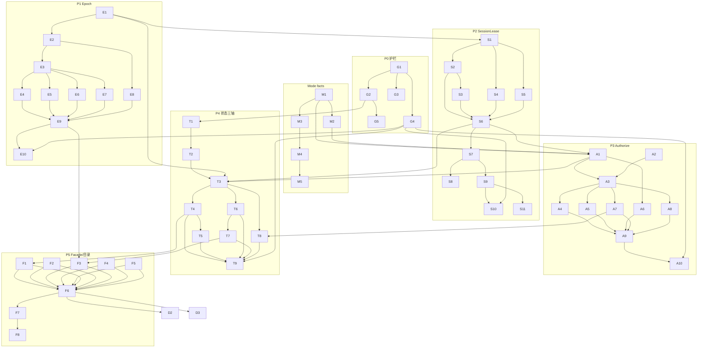

# Core 控制面收敛任务列表（Control Plane Convergence）

> 来源：上一轮《Core 生命周期 / 状态 / 权限与会话归属 架构收敛分析》（对话交付，未落盘）的落地任务拆分；覆盖矩阵见 §4。
> 范围：`packages/core`，只动控制面（生命周期、状态、权限、会话归属）。
> 跟踪方式：任务 ID 稳定；执行记录放在 issue/PR 标题前缀（如 `[S7]`），本文件不维护状态列。
> 不动：事件总线、日志 seam、工具注册/呈现、压缩算法、models/provider/media/LSP/tree-sitter。
> 状态：规划稿（未实施）。规模定义：S ≤ 1 人日，M 1–3 人日，L 3–5 人日。

---

## 0. 目标与验收基线

### 0.1 收敛目标（量化）

| 指标 | 现状 | 目标 | 归属任务 |
|---|---:|---:|---|
| status 语义写入者 | 4 文件 / 35 调用点 | 1（`transition()`） | T1–T4 |
| "当前性"机制 | 9 | 1（`Epoch`） | E1–E9 |
| 权限判定入口 | 13 | 1 管线 / 7 阶段 | A1–A9 |
| session 端口成员 | 36（4 端口，最大 16） | ≤ 15（单端口，可选） | S6/S9 |
| `ManagedAgent` | 3091 行 / ~176 方法 | facade < 400 行 + 6 facets | F1–F5 |
| status trigger | 21 | ~8 迁移事件 | T5 |
| plan/auto 散读 | 47 / 6 处（代码读点） | 收敛到 `ModeState` | M1–M5 |

### 0.2 全局前置条件（每个任务默认继承）

1. 仓库已构建（`pnpm build`），`pnpm typecheck` / `pnpm lint` 可运行。
2. `node scripts/run-all-validators.mjs --dir packages/core` 为绿（当前 263 passed / 2 环境 skip）。
3. 每个 PR 只做一个任务或一组强相关任务；行为保持阶段先加适配器、后删旧路径。
4. 任何涉及"新增唯一写入者"的任务，必须先提交等价性断言（G4），再删旧写入点。
5. 不改 wire 协议、事件名、公共导出（除非任务明确列出）。

---

## 1. 任务总览

### P0 · 护栏与基线（Guardrails）

| ID | 任务 | 规模 | 前置 | 关键验收 |
|---|---|---|---|---|
| G1 | 控制面清册：所有 status / epoch-guard / ownership / approval 的读写点清单；`validate:control-plane-writers`（源码扫描 + 白名单，阻止新增散点） | M | — | 扫描输出与清册一致；新散点会让校验失败 |
| G2 | 不变量目录：把 `CALL ORDER IS THE CONTRACT` 类注释抽成 `docs/core-control-plane-invariants.md`，标注"已结构化 / 仅注释" | M | — | 每条不变量都能映射到 T/S/A 任务或"永久注释"理由 |
| G3 | 基线指标脚本：LOC、方法数、status trigger、guard 数量、validator 数量 → CI artifact | S | — | 报告可重复生成，数值与本文 0.1 一致 |
| G4 | 等价性测试工具 `scripts/helpers/equivalence.mjs`：同一场景跑 old/new 两条路径并 diff 可观察结果 | M | G1 | 至少被 E10/S10/A10 复用 |
| G5 | 现有 265 个 validator 与任务的映射 + 缺口清单 | S | G1, G2 | 每个控制面任务都有对应验收脚本或标注"需新增" |

### P1 · Epoch：单一"当前性"令牌

| ID | 任务 | 规模 | 前置 | 关键验收 |
|---|---|---|---|---|
| E1 | 定义 `Epoch` / `EpochSource`：`sessionGen + runToken + lifecycleGen + isCurrent()`（`runtime-types`，type + 小实现） | M | G4 | 类型可被 host/facet 注入，无 core 单例 |
| E2 | RunCoordinator / UIChannel / ChatController 暴露 generation 源（适配器，不删除旧机制） | S | E1 | 三代际同源；旧 token 仍工作 |
| E3 | `captureEpoch()` 注入持久化/usage 路径（`SessionHost`、`SessionPersistence`） | M | E1,E2 | 现有 persist 测试全绿 |
| E4 | 标题 usage 改用 epoch（替换 `stillOnSession` / `sessionIdAtStart`） | S | E3 | `validate:session-model-persistence` + 新增切换竞态用例 |
| E5 | 记忆抽取 usage/persist 改用 epoch（替换 `stillOnStartSession`） | S | E3 | `validate:memory-*` + 切换竞态用例 |
| E6 | 后台完成 wake 改用 epoch（替换 `isSessionSwitching()` 试跑检查） | M | E3 | `validate:background-wake` |
| E7 | subagent usage/part 写回改用 epoch（替换 `usageCurrent` 代际） | M | E3 | `validate:background-task`、task-result 用例 |
| E8 | ChatController 的 stale 写改用 epoch（替换 `captureSessionStaleness` / `lifecycleEpoch` 手写判断） | M | E2 | `validate:session-staleness`、run-finalization |
| E9 | 删除旧机制：`sessionIdAtStart` / `stillOn*` / 异步路径上的 `isSessionSwitching`；保留 `RunToken` 为 Epoch 内部实现 | M | E4–E8 | `validate:control-plane-writers` 不再报旧 guard |
| E10 | `validate:epoch-equivalence` + `validate:epoch-single-source` | M | G4,E1–E9 | 迁移矩阵 old/new 一致；新增散点失败 |

### P2 · SessionLease：单一会话所有者

| ID | 任务 | 规模 | 前置 | 关键验收 |
|---|---|---|---|---|
| S1 | `SessionLease` 状态机：`unclaimed → claimed → restoring → active → draining → released` + `generation` | M | E1 | 状态矩阵单测；非法迁移 dev 抛错 |
| S2 | 用 lease 包装 `SessionOwnership`（Map 作为存储实现） | S | S1 | `validate:session-ownership` |
| S3 | 磁盘 reservation / restore placeholder 归入 lease（reuse vs resume 两种 claim） | M | S1,S2 | 失败释放只针对本 lease；`--resume` 目标不被误放 |
| S4 | log sink 绑定归入 lease 阶段（claim/commit/drain 触发） | M | S1 | `validate:agent-log-binding`、session-reuse-log |
| S5 | tracker / 持久化指纹归入 `lease.commit`（修复写入方与被修复方一致） | M | S1 | `validate:session-persist-coalescing`、restore-state |
| S6 | `SessionRuntime` 聚合 + 4 端口：`RunControl` / `TranscriptPort` / `ModePort` / `SidecarPort` | L | S1–S5 | 端口可独立 fake；host 侧不 import ManagedAgent |
| S7 | `SessionLifecycleService` 的 unload/load/commit/rollback 改为 `lease.switchTo()` 阶段；保留 `serializeSwitch` 为 lease 内部锁 | L | S6 | `validate:session-switch-safety`、session-branching |
| S8 | 背景工作 reset 变成 sidecar 端口并被切换事务 **await**（修 `void reset()`） | S | S6,S7 | 切换后立刻 re-resume 不丢/不删记录 |
| S9 | `SessionLifecycleHost`（38 成员）→ `SessionRuntime` 4 端口（36 成员，最大 16）；ManagedAgent 装配更新 | L | S6 | typecheck + switch/branching 套件 |
| S10 | `validate:session-lease-matrix`：new/resume/同 id/异 id/各阶段失败/clone/fork × 副作用（ownership/sink/tracker/background/log 边界/事件） | L | G4,S1–S9 | 矩阵全绿；故障注入回滚成功 |
| S11 | 删除重复 guard + `local-agent-session-host` 预留逻辑收敛到 lease | S | S9 | `validate:local-agent-session`、session-host |

### P3 · Authorize：单一权限决策管线

| ID | 任务 | 规模 | 前置 | 关键验收 |
|---|---|---|---|---|
| A1 | `AgentPolicyFacts`：mode phase / auto / `todosSeeded` / subagent profile / rules / env / capabilities | M | M1,M2 | facts 是纯数据，可快照测试 |
| A2 | `RegisteredTool.approval: ApprovalRequirement`：静态 `needsApproval` + MCP annotations 合并到注册描述 | M | G1 | 39 处裸 `needsApproval` 读取改为描述符 |
| A3 | `authorizeToolCall()` 组合器：7 阶段顺序先调用现有判定函数（零行为变化） | L | A1,A2 | 决策与原路径等价（G4） |
| A4 | 命令安全进管线；移除 ChatController 的 `applyCommandSafetyPolicy` 调用 | M | A3 | `validate:command-safety*`、approval-decisions |
| A5 | extension `tool:before:*` 进管线（deny 来源 + `modifiedArgs` 拒绝记录） | M | A3 | extensions-middleware / tool-safety |
| A6 | plan / subagent / code-mode 的"可用性"进 facts；工具列表改为同一 policy 的投影 | M | A1,T1 | `validate:plan-session`、code-mode、tool 列表快照 |
| A7 | auto / plan-execution 自动批准进管线；`ApprovalDecisionCoordinator` 只负责写答案 | M | A3 | `validate:auto-mode-approvals`、approval-batch-resume |
| A8 | 单一 decision store：审批表为 SoT，channel part / JSONL 为投影，事件带 `source` | M | A3 | 一份决定只产生一条记录（日志断言） |
| A9 | 删除重复闸门与裸 `needsApproval` 读取 | M | A4–A8 | `validate:control-plane-writers` |
| A10 | `validate:authorize-matrix`：工具 × 模式 × 路径 × env × subagent × rules × annotations | L | G4,A1–A9 | 每个组合只有一条决策、一个来源、一个记录 |

### P4 · 状态三轴 + 派生 status

| ID | 任务 | 规模 | 前置 | 关键验收 |
|---|---|---|---|---|
| T1 | `LifecyclePhase` / `RunPhase` / `WaitKind` + 迁移表（`agent/state/`） | M | G2 | 迁移表覆盖所有现有 trigger |
| T2 | 只读投影：从现有 status 计算三轴并写入 snapshot（不改写入者） | S | T1 | 现有快照字段不变；新增字段可断言 |
| T3 | 所有 `setStatus` 收敛到 `transition(event)`；删除公开 `setStatus` | L | T2,E1 | `validate:control-plane-writers` 只剩一处 |
| T4 | 删除 `TERMINAL/ACTIVE` 重叠与 `resolveFinishStatus` 特判；终态/活跃由 phase+wait 派生 | M | T3 | `validate:agent-status`、status-log |
| T5 | trigger 21 → ~8 迁移事件；更新日志规则与 validator | M | T3,T4 | 状态日志语义不丢；行数下降 |
| T6 | `compacting` 移出 status，改为 `RunPhase`/operation lease 表达 | M | T3,S1 | manual-compact-interlock、reactive-compact |
| T7 | ChatController pump 改为状态机事件（替换 `deriveChatOutcome` 手写排名） | L | T3,T6,E8 | run-finalization、pump-continuation |
| T8 | approval / `ask_user` 等等待建模为 `WaitKind`；删除 `parkOnPendingQuestion` 特例 | M | T3,A7 | approval-batch-resume（含 Esc 用例） |
| T9 | `validate:state-transition-matrix` + 旧 status 等价性断言 | M | G4,T1–T8 | 每个事件 × 每个 phase 都有期望 |

### P5 · ManagedAgent 分面 + 目录按领域

| ID | 任务 | 规模 | 前置 | 关键验收 |
|---|---|---|---|---|
| F1 | 抽 `managed-agent-model-state.ts`（applyPersistedModel / refreshModelMetadata / syncCompactionBudget 簇） | M | T4 | typecheck + model-selection 套件 |
| F2 | 抽 `managed-agent-session-state.ts`（session data / tracker / ownership 视图） | M | S9 | session 套件 |
| F3 | 抽 `managed-agent-run-state.ts`（委托 RunCoordinator，去掉重复字段） | M | E9,T7 | run 套件 |
| F4 | 抽 `managed-agent-mode-state.ts`（plan/auto/approval 视图） | M | M4 | mode 套件 |
| F5 | 抽 `managed-agent-tool-state.ts` / `managed-agent-extension-state.ts` | M | A9 | tool/extension 套件 |
| F6 | 目录迁移：`agent/{run,session,approval,mode,compaction}/`（纯移动，不改逻辑） | L | F1–F5 | layer-boundaries、module-organization |
| F7 | host 端口最终落位 `runtime-types`；删除 `managers/` 下的遗留 host 接口 | S | S9,F6 | core-public-exports |
| F8 | 文档模块图、file-size allowlist、import 路径更新；全量校验 | M | F6,F7 | 全部 validator + typecheck |

### 横切 · Mode facts（并入 P2/P3 之间）

| ID | 任务 | 规模 | 前置 | 关键验收 |
|---|---|---|---|---|
| M1 | `ModeState` 只读 API：`planPhase` / `auto` / `approvalPolicy(tool)` / `toolAvailability()` | M | G1 | 只读 API 可 fake，无副作用 |
| M2 | `todosSeeded` 归入 `AgentPolicyFacts`（plan-execution 自动批准的唯一条件） | S | M1 | plan-verification、auto-mode-approvals |
| M3 | persistence / turn-context / status / plan tools 只读 `ModeState` | M | M1 | 相关套件全绿 |
| M4 | 收敛 plan/auto 散读（47/6 → 仅 mode 域 + facts） | M | M1,M3 | `validate:mode-single-read` |
| M5 | source guard：禁止 `agent/mode/` 外直接读 `planMode.*` / `isAutoModeEnabled()` | S | M4 | 新散读失败 |

### 收尾 · 文档 / 校验 / 灰度

| ID | 任务 | 规模 | 前置 | 关键验收 |
|---|---|---|---|---|
| D1 | 把"顺序契约"注释替换为状态机/端口引用；只保留跨模块不变量 | M | 各阶段 | G2 目录全部标记"已结构化"或给出理由 |
| D2 | 更新 `ARCHITECTURE.md`：状态表、会话生命周期、权限模型、模块图 | M | F6 | 文档与代码一致（review） |
| D3 | 更新 `AGENTS.md`：控制面所有权、validator 清单、目录规则 | M | F6 | 引用路径全部可解析 |
| D4 | 合并/删除被矩阵取代的旧 validator | S | T9,A10,S10 | 全量 validator 绿 |
| D5 | CI 加入 `control-plane-writers` / 指标报告 | S | G1,G3 | PR 失败可复现 |
| R1 | 每阶段 adapter/flag 与删除清单（禁止永久双写） | S | 各阶段 | 阶段结束时旧路径已删 |
| R2 | 指标趋势看板（CI artifact：writers/guards/LOC/trigger） | S | G3 | 趋势可见 |
| R3 | 每阶段回滚预案（哪些 commit 可独立 revert） | S | 各阶段 | 演练一次 |
| R4 | 每阶段 DoD 检查单（见 §5） | S | 各阶段 | 阶段验收记录 |

---

## 2. 依赖关系

### 2.1 主依赖图



### 2.2 关键前置条件说明

- **P1 必须先于 P2/P4**：`SessionLease` 的 generation 与状态机的 `isCurrent` 都复用 `Epoch`；否则会再造一套代际。
- **P2 必须先于 P3/P4 的写入收敛**：`authorizeToolCall` 需要在切换事务里安全地写决定；状态机的 `transition()` 需要 session scope 才能判断"是否仍是当前会话"。
- **M1/M2 必须先于 A1**：`AgentPolicyFacts` 直接消费 `ModeState` 与 `todosSeeded`。
- **A7 必须先于 T8**：等待态（含 `ask_user`）的来源统一到 authorize 决策后，才能把 `WaitKind` 建模为唯一等待来源。
- **T4 必须先于 F1**：model facet 的终态写入要跟随状态机，而不是旧 `setStatus`。
- **F 组最后做**：纯机械移动，必须等控制面语义稳定，避免边改边搬。

---

## 3. 执行波次（含并发/文件冲突说明）

| 波次 | 任务 | 并行性 | 冲突提示 |
|---|---|---|---|
| Wave 0 | G1–G5 | 全并行 | 无 |
| Wave 1 | E1–E10 + M1–M5 | E 串行（E1→E2→E3→分支→E9→E10）；M 可并行 | `agent-chat-controller.ts` 会被 E8 改；M3 也会碰，按 E8 先、M3 后 |
| Wave 2 | S1–S11 | S1 先行；S2–S5 可并行；S6→S7→S8 串行 | S7/S9 触碰 `managed-agent.ts` + `session-lifecycle-service.ts` |
| Wave 3 | A1–A10 | A1/A2 并行 → A3 → A4/A5/A6/A7/A8 并行 → A9/A10 | A4/A7 触碰 chat controller（E8 已改过，基于最新版本） |
| Wave 4 | T1–T9 | T1→T2→T3 串行；T4/T5/T6/T8 部分并行；T7 最后 | T7 与 A7 都碰 pump，按 A7 先、T7 后 |
| Wave 5 | F1–F8 + D1–D5 + R1–R4 | F 串行（F1–F5 可并行）；D 跟随 | F6 是纯移动，单独 PR，避免与逻辑改动混合 |

**总规模**：L 任务 9 个、M 任务 ~34 个、S 任务 ~24 个；建议按波次拆 8–12 个 PR，每波一个可独立回滚的合并点。

---

## 4. 分析报告覆盖矩阵

| 报告章节 | 对应任务 |
|---|---|
| §0 结论（数据面已收敛 / 控制面零散） | G1、G2、D1 |
| §1 现状地图（9 个关注点） | G1、G2、M1、A1、S6、T1 |
| §2.1 status 三轴 / TERMINAL 与 ACTIVE 重叠 | T1–T5 |
| §2.2 九套"当前性"机制 | E1–E10 |
| §2.3 会话归属六种存储 + 38 成员 host | S1–S11 |
| §2.4 权限 13 个入口 / 三份决定表示 | A1–A10 |
| §2.5 Mode 散读 47/6 处 | M1–M5 |
| §2.6 类/接口体量（3091 行、38、30、18.7k） | F1–F8、S9、G3 |
| §3 根因 1（注释契约） | G2、D1、T1、S7 |
| §3 根因 2（九种代币） | E1–E10 |
| §3 根因 3（status 三轴） | T1–T9 |
| §3 根因 4（权限逐入口） | A1–A10 |
| §3 根因 5（归属六存储） | S1–S11 |
| §3 根因 6（目录按角色） | F1–F8 |
| §4 主线 A（Epoch） | E1–E10 |
| §4 主线 B（SessionLease/SessionRuntime） | S1–S11 |
| §4 主线 C（authorizeToolCall） | A1–A10 |
| §4 主线 D（状态三轴） | T1–T9 |
| §4 主线 E（分面/目录） | F1–F8 |
| §4 目标结构草图 | F6、D2 |
| §5 迁移路线 P0–P5 | Wave 0–5、R1、R4 |
| §6 不建议收敛的部分 | §7 本文"非目标" |
| §7 收益/成本/优先级 | §0.1、§6、§8 |

---

## 5. 每阶段 Definition of Done

### P0
- [ ] 控制面清册与指标脚本进 CI。
- [ ] 不变量目录完成，能逐条指向任务。
- [ ] 等价性工具被至少一个后续任务实际使用。

### P1（Epoch）
- [ ] 所有跨 `await` 的写入（usage/persist/wake/subagent settle）都带 epoch。
- [ ] 旧 guard 全部删除，`validate:control-plane-writers` 不报。
- [ ] E10 等价矩阵覆盖：切换前/中/后、失败 restore、并发标题、并发抽取。

### P2（SessionLease）
- [ ] 所有会话归属/预留/占位/sink/tracker 只经 lease 变更。
- [ ] 切换事务可故障注入并回滚；背景 reset 被 await。
- [ ] host 接口 ≤15 成员；`SessionRuntime` 端口可独立 fake。

### P3（Authorize）
- [ ] 一次工具调用的决定只来自管线，记录只有一份。
- [ ] plan/subagent/code-mode 的"不可用"与"需审批"共用 facts。
- [ ] 拦截器 deny 与审批 deny 在同一决策模型里可区分。

### P4（状态三轴）
- [ ] `setStatus` 只剩 `transition()` 内部调用。
- [ ] 无 TERMINAL/ACTIVE 重叠、无 `compacting` 特判、无 `error+ask_user` 特例。
- [ ] 事件 × phase 迁移矩阵全绿。

### P5（Facade/目录）
- [ ] `ManagedAgent` < 400 行；facets 可单测。
- [ ] `managers/` 只保留 registry/telemetry/lifecycle；领域代码在 `agent/<domain>/`。
- [ ] 全量 validator + typecheck + lint 绿。

---

## 6. 风险与缓解

| 风险 | 影响 | 缓解 | 关联任务 |
|---|---|---|---|
| 切换事务语义回归（丢消息/重复写入） | 高 | S10 故障注入矩阵；lease 阶段先并行运行新旧路径 | S1–S10 |
| 审批顺序变化导致安全回退 | 高 | A3 先组合旧函数；A10 决策矩阵；默认 fail-closed | A3–A10 |
| 状态机遗漏路径导致"永远 running" | 高 | T9 迁移矩阵 + 超时断言；保留旧 reconcile 一个版本 | T3–T9 |
| Epoch 漏接续体导致静默写错会话 | 中 | G1 清册 + E9 源码守卫 + 审计异步写入点 | E3–E9 |
| 目录迁移与逻辑改动混在一起 | 中 | F6 纯移动、单独 PR；禁止同 PR 改逻辑 | F6 |
| 适配器长期不删（双写） | 中 | R1 每阶段删除清单；阶段 DoD 检查 | R1、R4 |
| 文档/注释契约过期 | 低 | D1/D2/D3 跟随阶段更新；G2 目录核对 | D1–D3 |

---

## 7. 非目标（明确不做）

- 不重写/合并 `AgentEventBus`、`AgentLog`、log 规则表。
- 不重构工具注册/呈现（`defineServerTool({ present })` 已收敛）。
- 不改压缩算法（cut-point / keep-policy / summarizer / reactive 分类）。
- 不动 `models/`、`provider/`、`media/`、`tree-sitter/`、LSP 实现。
- 不把 `runtime-types` 变成 service locator；它保持 type-only 端口枢纽。
- 不改 wire 事件名、`AgentSessionSnapshot` 的既有字段语义（只新增三轴字段）。
- 不改变扩展 API（`ExtensionContext` / `ExtensionAPI` 的注册面与租约语义）。

---

## 8. 附录

### 8.1 目标模块图

```text
managers/
  managed-agent.ts                 # facade（< 400 行）
  managed-agent-model-state.ts
  managed-agent-session-state.ts
  managed-agent-run-state.ts
  managed-agent-mode-state.ts
  managed-agent-tool-state.ts
  managed-agent-extension-state.ts
  agent-manager.ts                 # registry + lifecycle + telemetry
  lifecycle-coordinator.ts
  telemetry/

agent/
  state/                           # 三轴 + 迁移表 + status 投影
  run/                             # coordinator / pump / finalizer / span / recovery
  session/                         # lease / runtime ports / switch / persistence / ownership / store
  mode/                            # plan / auto / coordinator / ModeState
  approval/                        # table / decisions / pipeline(authorize)
  compaction/                      # controller / auto / reactive（算法不动）
  extension/                       # 现状不变
  tools/                           # 现状不变
```

### 8.2 关键不变量清单（G2 的初始内容）

| 不变量 | 现状编码 | 收敛后 |
|---|---|---|
| bootstrap 顺序 create → register → bootstrap → ready | 注释 + `agent-factory` try/catch | `LifecyclePhase` 迁移表 |
| run 顺序 prepare → stream → tool phase → finalize | 注释 + `RunFinalizer` 顺序 | `RunPhase` 迁移表 |
| 切换 unload → adopt → commit → reset → rebind | 注释 + `SessionLifecycleService` | `SessionLease.switchTo` 阶段 |
| compaction lease 唯一所有者 | `CompactionController` | 保留 + `RunPhase` 投影 |
| 扩展注册租约（每 incarnation 一个 context） | `context-factory` | 保留 + 正式 state enum |
| 审批先答者胜 / pending 才能答 | `ToolApprovalTable` | 保留 + decision store |
| 结果写入必须属于当前会话/run | 9 种 guard | `Epoch.isCurrent()` |

### 8.3 参考位置（分析报告引用）

- `runtime-types/agent-status.ts`（状态/trigger/TERMINAL·ACTIVE）
- `managers/run-coordinator.ts`、`managers/controllers/agent-chat-controller.ts`、`agent/ui/ui-channel.ts`、`agent/turn-context/session-staleness.ts`
- `managers/services/session-lifecycle-service.ts`（38 成员 host）
- `managers/approval-decision-coordinator.ts`、`managers/middleware/extensions-middleware.ts`、`managers/run-agent.ts`
- `managers/managed-agent.ts`、`agent-session/types.ts`
